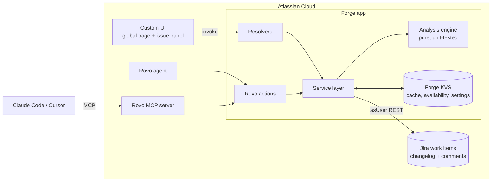
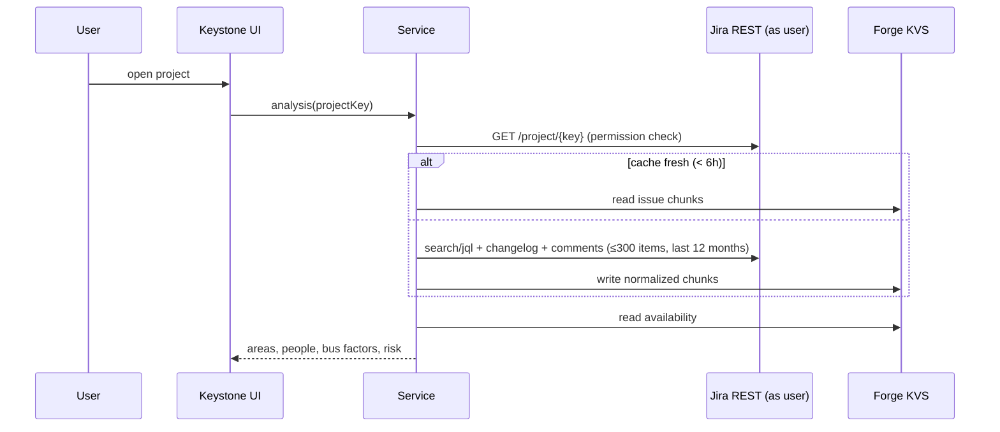

# Keystone — knowledge-risk radar for Jira

> Find the single points of knowledge failure in your team before a vacation, resignation or re-org finds them for you.

Keystone is an [Atlassian Forge](https://developer.atlassian.com/platform/forge/) app for Jira, built for **Codegeist 2026** (category: *Apps for Software Teams*; bonus: *Best Rovo Agents*, *Best app with Atlassian MCP*).

It reads who actually did the work in Jira — who resolved it, who moved it through the workflow, who discussed it — and turns that into a **bus factor for every component, epic and label**. Teams get a risk map, a "what-if" simulator for absences, one-click handover tasks, and the same context inside **Rovo** and in **any MCP-capable coding agent**.

## The problem

Every team has areas only one person really understands. Nobody notices until that person is on leave during an incident, or hands in their notice. Existing "bus factor" tools only look at git history, so they miss the people who triage, review, decide and support — the context that lives in Jira. And AI coding agents now change code with no idea who to ask about it.

## What it does

| Surface | What you get |
|---|---|
| **Jira global page** (Apps → Keystone) | Overview with team bus factor, areas at risk, single-holder areas and % of open work resting on one person; colour-coded risk map; *Keystone people* ranked by how much risk rests on them |
| **Areas** | Searchable, filterable list; each area shows holders with their share, why it's flagged, open work and a "read first" list |
| **People** | Availability (on leave / leaving), Keystone index, and a generated **handover plan** with successors, work to transfer and reading list — exported as **Jira tasks** or Markdown |
| **What-if** | Pick any people; see which areas lose every key holder and how much open work is exposed |
| **Issue panel** | On every work item: who holds the context for its area, bus factor, and a warning if they're away |
| **Rovo agent** | "Who knows the most about tax?", "What breaks if Maya goes on leave?", "Draft a handover plan for Omar" |
| **MCP server** (`rovo:mcp`) | The same five tools for Claude Code, Cursor and other MCP clients, so coding agents can ask who holds context before changing an area |

A built-in **sample workspace** (a fictional payments team, always labelled *Sample data*) lets anyone explore Keystone on an empty site.

## How it works





### The model

- **Area** = component → else parent epic → else first label.
- **Context share** per person per area, from Jira activity: resolved assignee 3, open assignee 1.5, status transition 0.5, comment 0.5 (max 3 per issue), reporter 0.5. Every contribution decays with a **180-day half-life**, so recent work counts more.
- **Bus factor** = fewest people whose shares add up to ≥ 50%.
- **Risk score (0–100)** = concentration (top share) + single holder + open work in the area + an idle main holder (> 90 days) + key holders who are away or leaving. Every flag comes with a plain-language reason.
- **Team bus factor** = how many key holders (≥ 20% share) you can remove, most-connected first, before more than half the areas have none left.
- **Keystone index** = sum of (share × area risk) for one person, scaled 0–100. It measures fragility, **not** performance.

## Security and privacy

- **Runs on Atlassian:** no external services, no egress, no third-party AI. Rovo provides the language layer.
- All Jira reads use `asUser()`, so people only see what Jira already lets them see. Cached project data is served only after a live permission check on that project.
- Users can set their own availability; changing someone else's requires Jira admin permission. Each change records who set it.
- Scopes: `read:jira-work`, `read:jira-user`, `write:jira-work` (handover tasks only), `storage:app`.

## Project structure

```
manifest.yml          Forge modules: global page, issue panel, Rovo agent, actions, rovo:mcp
agent/prompt.md       Rovo agent instructions
src/engine/           Analysis engine (pure JS) + sample workspace
src/jira/             Jira REST client + normalizer
src/service.js        Caching, permissions, availability, handover tasks
src/index.js          Resolvers and Rovo action handlers
static/app/           React 19 + Vite Custom UI
test/                 Node test runner unit tests
```

## Run it yourself

Prerequisites: Node 22, an [Atlassian developer site](https://go.atlassian.com/cloud-dev), and the Forge CLI (`npm i -g @forge/cli`, then `forge login`).

```bash
npm install
npm --prefix static/app install
npm test                     # engine unit tests
npm run build:ui             # builds static/app/dist
forge register               # first time only: writes your app id into manifest.yml
forge deploy
forge install --site <your-site>.atlassian.net --product jira
```

UI development without a site: `npm --prefix static/app run dev` runs the UI against an in-browser mock that uses the real engine on the sample workspace.

## Using it

1. In Jira, open **Apps → Keystone**. The sample workspace loads first; pick a real project from the menu to analyse it (up to 300 items updated in the last 12 months).
2. Open any work item and expand **Keystone · context holders**.
3. In Rovo chat, choose the **Keystone** agent and try a conversation starter.
4. To use the MCP tools from a coding agent, a site admin enables the Keystone tools for external clients in Atlassian Administration, then you connect your client to the Atlassian Rovo MCP server.

## License

MIT
