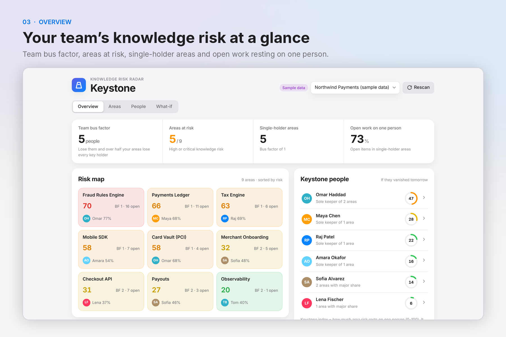
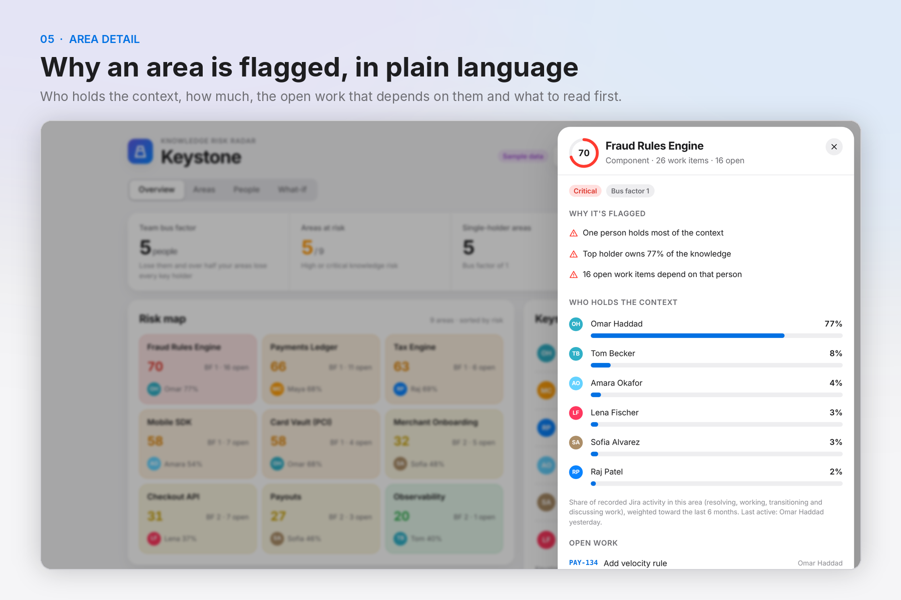
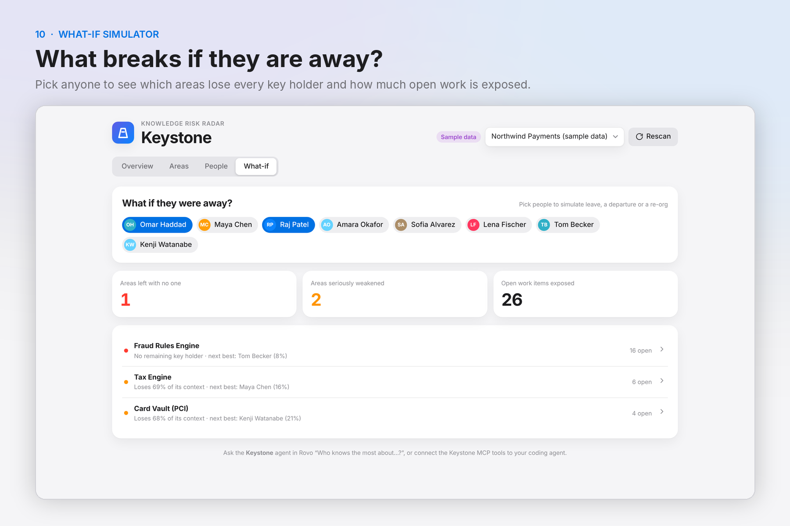
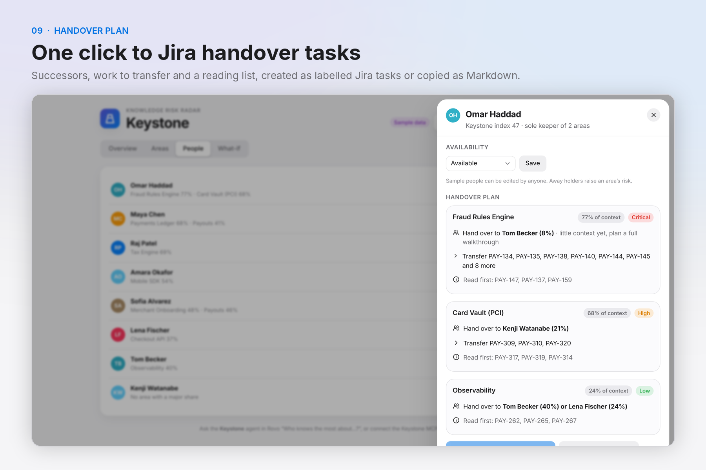
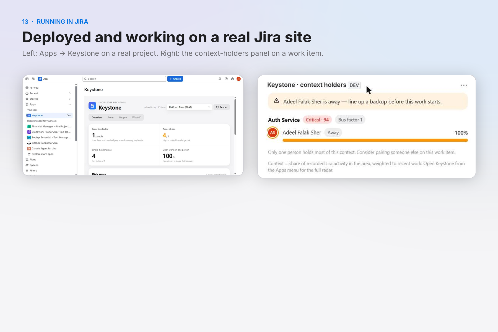
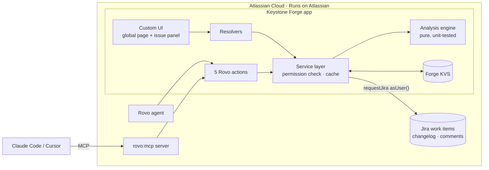
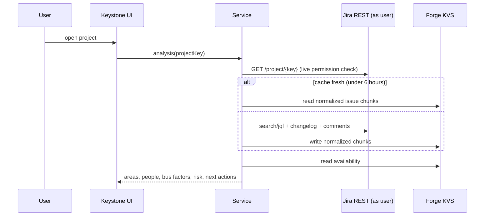

<div align="center">


# Keystone

**The knowledge-risk radar for Jira.**
Find your team's single points of knowledge failure before a vacation, resignation or re-org does.


Built for **Codegeist 2026: Build with context. Ship with confidence.** · Category: *Apps for Software Teams*



</div>

---

## Contents

- [Why Keystone](#why-keystone)
- [What it does](#what-it-does)
- [How it works](#how-it-works)
- [Architecture](#architecture)
- [Security and privacy](#security-and-privacy)
- [Install and try it](#install-and-try-it)
- [Develop locally](#develop-locally)
- [Project structure](#project-structure)
- [Testing](#testing)
- [Limitations and roadmap](#limitations-and-roadmap)

## Why Keystone

Every team has a service, a rules engine or a release script that only one person really understands. That risk stays invisible until the person is on leave during an incident or hands in their notice, and a "two-day fix" turns into two weeks of archaeology.

Existing bus-factor tools read git history only. They miss the triage, decisions, reviews and support work that live in Jira. And AI coding agents now change code with no idea who holds the context to review it.

Keystone measures where context actually lives in Jira, explains why it is fragile, and helps the team spread it.

## What it does

| Surface | What you get |
|---|---|
| **Jira global page** (Apps → Keystone) | Team bus factor, areas at risk, single-holder areas and the share of open work resting on one person; a colour-coded **risk map**; **Keystone people**; **next best actions** |
| **Areas** | Every component, epic and label ranked by risk, with plain-language reasons, context holders, open work and a "read first" list |
| **People** | Availability (on leave / leaving), Keystone index, and a generated **handover plan**: successors, work to transfer, reading list, created as **Jira tasks** in one click or copied as Markdown |
| **What-if** | Select any people and see which areas lose every key holder and how much open work is exposed |
| **Issue panel** | On every work item: who holds the context for its area, its bus factor, and a warning if they are away |
| **Rovo agent** | "Where is our knowledge risk?", "Who knows the most about tax?", "What breaks if Maya goes on leave?", "Draft a handover plan for Omar" |
| **MCP server** (`rovo:mcp`) | The same five tools for Claude Code, Cursor and other MCP clients, so coding agents can check who holds context before changing an area |

A built-in **sample workspace** (a fictional payments team, always labelled *Sample data*) lets anyone explore every feature on an empty site.

<table>
<tr>
<td></td>
<td></td>
</tr>
<tr>
<td align="center"><sub>Area detail: why it is flagged and who holds the context</sub></td>
<td align="center"><sub>What-if: simulate absences before they happen</sub></td>
</tr>
<tr>
<td></td>
<td></td>
</tr>
<tr>
<td align="center"><sub>Handover plan with one-click Jira tasks</sub></td>
<td align="center"><sub>Running on a live Jira Cloud site</sub></td>
</tr>
</table>

## How it works

1. **Collect.** For the selected project, Keystone reads up to 300 work items updated in the last 12 months, with their status changes and comments, using the signed-in user's permissions.
2. **Group into areas.** Each work item belongs to its components; otherwise its parent epic; otherwise its first label.
3. **Measure context.** Each person earns weight per work item:

   | Signal | Weight |
   |---|---|
   | Assignee of resolved work | 3 |
   | Assignee of open work | 1.5 |
   | Status transition | 0.5 |
   | Comment (max 3 per work item) | 0.5 |
   | Reporter | 0.5 |

   Every contribution decays with a **180-day half-life**, so recent work counts more.
4. **Score.**
   - **Bus factor** of an area = fewest people whose shares add up to at least 50%.
   - **Risk (0-100)** = concentration of the top holder, a single holder, open work in the area, an idle main holder (over 90 days), and key holders who are away or leaving. Every flag carries a reason.
   - **Team bus factor** = how many key holders (at least 20% share) can be removed, most-connected first, before more than half the areas have none left.
   - **Keystone index** = the area risk resting on one person, scaled 0-100. It measures fragility, **not** performance.
5. **Act.** Next best actions, handover plans and what-if simulations turn the scores into concrete steps.

## Architecture





| Layer | Technology |
|---|---|
| Platform | Atlassian Forge, Node.js 22 runtime |
| Modules | `jira:globalPage`, `jira:issuePanel`, `rovo:agent`, 5 × `action`, `rovo:mcp` |
| UI | React 19, Vite, Atlassian theme tokens (light and dark) |
| Data | Jira Cloud REST API v3 via `requestJira` as the user; Forge KVS |
| Tests | Node.js test runner |

## Security and privacy

- **Runs on Atlassian.** No external services, no egress, no third-party AI. Forge reports the app eligible for *Runs on Atlassian*; Rovo provides the language layer.
- **User permissions everywhere.** All Jira reads use `asUser()`. Cached project data is served only after a live permission check on that project.
- **Least privilege.** Scopes: `read:jira-work`, `read:jira-user`, `write:jira-work` (handover tasks only), `storage:app`.
- **Governed availability.** Users can set their own availability; changing someone else's requires Jira admin permission. Every change records who made it and when.
- **Minimal storage.** Comment text and descriptions are never stored. The cache expires after 6 hours. See [PRIVACY.md](PRIVACY.md).
- **No secrets in the repository.** Forge handles authentication; there are no API keys or environment files to configure.

## Install and try it

1. Install Keystone on a Jira Cloud site with the installation link from the Devpost submission.
2. Open **Apps → Keystone**. The sample workspace loads first, so you can try everything immediately:
   - **Overview:** click a tile on the risk map.
   - **People:** open a person, set *On leave*, and watch risk update; review the handover plan.
   - **What-if:** select one or more people.
3. Choose a real project in the project menu to analyse your own data.
4. Open any work item and expand **Keystone · context holders**.
5. **Rovo:** open Rovo chat → Agents → **Keystone**, and try a conversation starter.
6. **MCP:** a site admin enables the Keystone tools for external clients in Atlassian Administration; then connect your MCP client to the Atlassian Rovo MCP server.

## Develop locally

Prerequisites: Node.js 22, an [Atlassian developer site](https://go.atlassian.com/cloud-dev), and the Forge CLI.

```bash
npm install -g @forge/cli
forge login

git clone https://github.com/adeelfalaksher900-creator/keystone-forge.git
cd keystone-forge
npm install
npm --prefix static/app install

npm test                 # engine unit tests
npm run build:ui         # builds static/app/dist

forge register           # first time: writes your own app id into manifest.yml
forge deploy
forge install --site <your-site>.atlassian.net --product jira
```

UI without a site: `npm --prefix static/app run dev` runs the real UI and analysis engine in the browser against the sample workspace (an in-browser stand-in replaces the Forge bridge).

## Project structure

```
manifest.yml            Forge modules: global page, issue panel, Rovo agent, actions, rovo:mcp
agent/prompt.md         Rovo agent instructions
src/engine/analyze.js   Analysis engine: areas, context shares, bus factor, risk, what-if, handover, next actions
src/engine/sample.js    Deterministic sample workspace (fictional team)
src/jira/               Jira REST client and normalizer
src/service.js          Caching, permission checks, availability, handover tasks
src/index.js            Custom UI resolvers and Rovo action handlers
static/app/             React 19 + Vite Custom UI
test/                   Unit tests
```

## Testing

```bash
npm test
```

The engine tests cover bus factor, area grouping, risk with availability, what-if, handover plans, expert search, next best actions and the Jira REST normalizer. The deployed app was verified end to end on a live Jira Cloud site: global page, real project analysis, availability, handover task creation and the issue panel.

## Limitations and roadmap

- Analyses the newest 300 work items of the last 12 months per project to stay within Forge invocation limits.
- Works best when work items use components, epics or labels.
- Next: Confluence and Bitbucket signals (page authorship, pull request reviews), Teamwork Graph once its API is generally available, scheduled weekly risk digests, and trend tracking.

## License

[MIT](LICENSE) © 2026 Adeel Falak Sher
